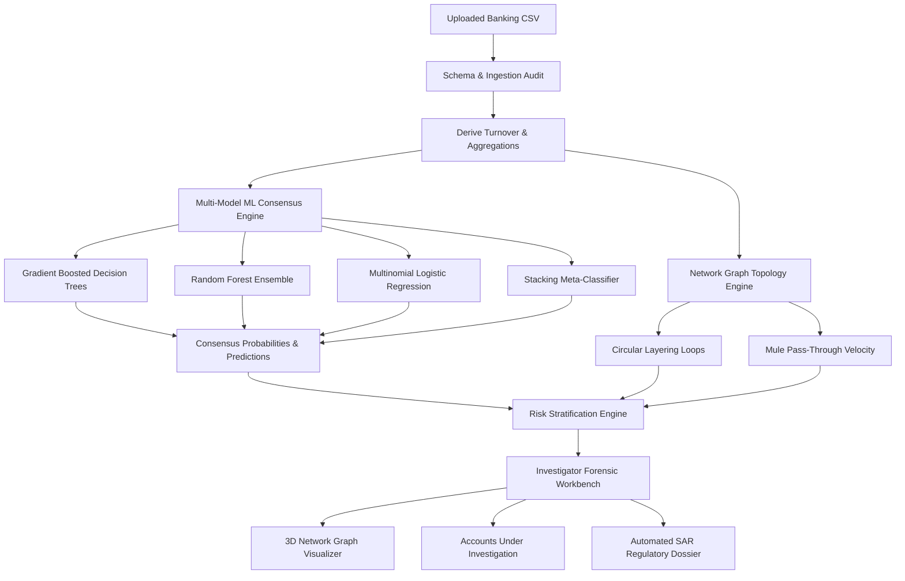
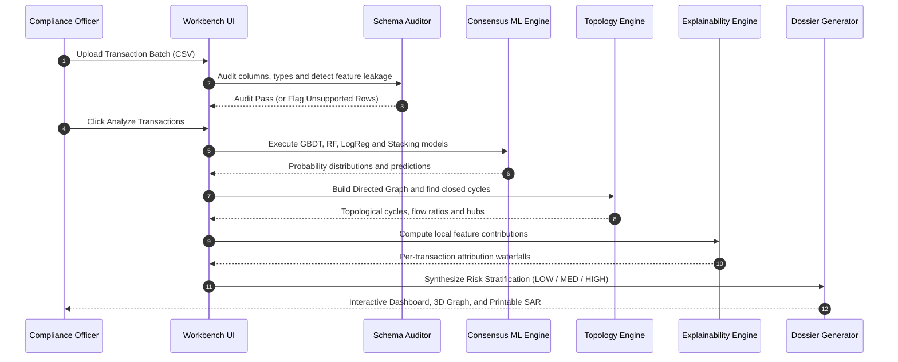

# AI-Based Anti-Money Laundering (AML) Detection & Intelligence System

<div align="center">
  
  <br />
  <h3>Enterprise Forensic Workbench for Banking Account & Transaction Surveillance</h3>
  <p>Multi-Model Consensus ML · Directed Graph Topological Analytics · Explainable AI (XAI) · Automated SAR Filing Dossiers</p>

  [](https://www.typescriptlang.org/)
  [](https://react.dev/)
  [](https://vitejs.dev/)
  [](https://tailwindcss.com/)
  [](https://threejs.org/)
  [](https://www.python.org/)
  [](https://scikit-learn.org/)
  [](https://networkx.org/)
  [](https://vitest.dev/)
</div>

---

> **Regulatory Compliance Mandate:**  
> This system is designed as an **investigator decision-support and alert-triage workbench**. In strict adherence to international financial compliance regulations (**FATF, FinCEN BSA, RBI PMLA, and OCC Model Risk Management SR 11-7**), automated algorithmic predictions prioritize and explain suspicious behavior—they do **not** establish definitive legal guilt. Every alert requires human review by a qualified AML/CFT compliance officer before filing a formal Suspicious Activity Report (SAR / STR).

---

## Table of Contents
1. [System Architecture & Data Flow](#1-system-architecture--data-flow)
2. [End-to-End Pipeline Workflow](#2-end-to-end-pipeline-workflow)
3. [Graph Topology & Circular Layering Rings](#3-graph-topology--circular-layering-rings)
4. [Supported AML Typologies](#4-supported-aml-typologies)
5. [Multi-Model Consensus & Machine Learning Engine](#5-multi-model-consensus--machine-learning-engine)
6. [Core Capabilities & Feature Matrix](#6-core-capabilities--feature-matrix)
7. [Step-by-Step Investigator Guide](#7-step-by-step-investigator-guide)
8. [Export Formats & Audit Trail](#8-export-formats--audit-trail)
9. [Project Directory Structure](#9-project-directory-structure)
10. [Local Development & Deployment Guide](#10-local-development--deployment-guide)
11. [Standalone Python / Flask Engine](#11-standalone-python--flask-engine)
12. [Real-World Institutional Calibration & Limitations](#12-real-world-institutional-calibration--limitations)

---

## 1. System Architecture & Data Flow

The platform is architected with a **dual-engine design**:
- **Client-Side TanStack Engine:** 100% browser-side execution for client confidentiality. Zero banking data leaves the browser session for model scoring.
- **Standalone Python Engine:** An offline microservice utilizing Scikit-Learn, Pandas, and NetworkX for institutional data-pipeline integration.

```text
+----------------------------------------------------------------------------------------------------+
|                                    1. INGESTION & SCHEMA AUDIT                                     |
|  [ Upload Banking CSV ] ---> [ Schema Validator & Column Normalizer ] ---> [ Zero-Leakage Audit ]  |
|                               (Raw Ledger or Account Profiles)                                     |
+-------------------------------------------------+--------------------------------------------------+
                                                  |
                         +------------------------+------------------------+
                         |                                                 |
                         v                                                 v
+--------------------------------------------------+ +-----------------------------------------------+
|         2. MULTI-MODEL ML CONSENSUS              | |           3. GRAPH TOPOLOGY ENGINE            |
|  * Gradient Boosted Decision Trees (GBDT)        | |  * Directed Weighted Graph Construction       |
|  * Random Forest Ensemble (Bagged Consensus)     | |  * Bounded Cycle Search (Circular Loops)      |
|  * Multinomial Logistic Regression Benchmark     | |  * Pass-Through Velocity (Mule Conduits)      |
|  * Stacking Meta-Classifier Fusion               | |  * Fan-In / Fan-Out Smurfing Aggregations     |
+------------------------+-------------------------+ +-----------------------+-----------------------+
                         |                                                   |
                         +------------------------+--------------------------+
                                                  |
                                                  v
+----------------------------------------------------------------------------------------------------+
|                                  4. EXPLAINABILITY & RISK TRIAGE                                   |
|  * Permutation & SHAP Feature Attributions   * Statutory Indicator Checks (CTR / Structuring)      |
|  * Triage Stratification: [ LOW RISK ] · [ MEDIUM REVIEW ] · [ HIGH PRIORITY ] · [ UNABLE ]        |
+-------------------------------------------------+--------------------------------------------------+
                                                  |
                                                  v
+----------------------------------------------------------------------------------------------------+
|                               5. INVESTIGATOR FORENSIC WORKBENCH                                   |
|  [ 3D / 2D Network Graph ] · [ Suspect Account Roster ] · [ Single-Transaction AI Diagnostic ]    |
|  [ Executive Threat Summary ] · [ Multi-Format Export: PDF / HTML / Markdown / CSV / JSON ]        |
+----------------------------------------------------------------------------------------------------+
```



---

## 2. End-to-End Pipeline Workflow

The screening lifecycle follows a six-stage sequential verification protocol designed to prevent data leakage and ensure reproducible audit trails:



---

## 3. Graph Topology & Circular Layering Rings

Money laundering syndicates rarely operate through isolated, direct transfers. Instead, they structure networks into **mule chains**, **funnel hubs**, and **closed circular layering rings** to obfuscate the paper trail.

### Typological Patterns Detected

```text
1. CIRCULAR LAYERING RING (Directed Loop)
   [Account A] ──$50,000──> [Account B] ──$49,200──> [Account C] ──$48,500──> [Account A]
   * Obfuscates capital origin by cycling funds across multiple distinct legal entities.

2. RAPID PASS-THROUGH MULE (Smurfing Aggregation)
   [Remitter 1] ──$9,500──┐
   [Remitter 2] ──$9,800──┼──> [Mule Account M] ──$29,000 (Within 2 Hours)──> [Beneficiary Z]
   [Remitter 3] ──$9,700──┘    (Turnover ~100%, Minimal Retention Balance)

3. FAN-OUT STRUCTURING DISPERSAL
                                ┌──$9,200──> [Beneficiary 1]
   [High-Risk Shell Entity] ───┼──$9,400──> [Beneficiary 2]
                                └──$9,100──> [Beneficiary 3]
```

### Visual Graph Exploration Modes
- **3D Spatial Force Graph (Three.js):** Interactive 3D orbital canvas featuring color-coded nodes (Red: High-Risk Shells/Mules, Amber: Pass-Through Conduits, Green: Verified Normal) with edge thickness proportional to transaction volume.
- **2D Directed SVG Diagram:** Clean topological layout highlighting flow direction and cycle paths.
- **Connection Ledger:** Filterable tabular view of all counterparties with inbound/outbound totals.
- **Account Dossier Inspector:** Deep-dive into any account's historical turnover, counterparties, and linked alert history.

---

## 4. Supported AML Typologies

The system's multi-model classifiers and rule engine screen for the following specific money-laundering typologies modeled directly from **FATF and FIU guidance**:

| Typology | Description | Primary Detection Indicators |
|---|---|---|
| **Structuring / Smurfing** | Breaking large sums into transfers just below statutory reporting thresholds ($10,000 / ₹50,000). | Multiple transfers between $9,000–$9,999 (or ₹45k–₹49.9k) in rapid sequence. |
| **Rapid Pass-Through Mules** | Intermediate accounts used to receive and immediately route funds with zero custodial retention. | In/Out ratio between 0.85–1.15; funds disbursed within hours; high counterparties. |
| **Circular Layering Loops** | Funds routed through multiple intermediate accounts only to return to originators or affiliates. | Directed graph simple cycle search identifying closed paths ($A \to B \to C \to A$). |
| **Dormant Account Activation** | Long-inactive accounts suddenly processing high-volume or international transfers. | High tenure (`account_age_months`), historically low volume followed by extreme turnover spikes. |
| **Velocity Spikes / Off-Hour Bursts** | Transactions executed during non-business hours (10:00 PM – 5:00 AM) at anomalous frequencies. | `night_activity_ratio > 0.40`; transaction bursts within narrow timestamps. |
| **High-Risk Corridors / Offshore** | Transfers routed to uncooperative tax havens or international accounts without commercial basis. | `international_tx_ratio > 0.60` with currency conversions and disparate counterparties. |

---

## 5. Multi-Model Consensus & Machine Learning Engine

### Algorithms Deployed in Consensus

```text
┌────────────────────────────────────────────────────────────────────────┐
│                   INPUT VECTOR: 10 TABULAR FEATURES                    │
│ [customer_type, account_age, avg_balance, monthly_inflow, ... ]        │
└───────────────────────────────────┬────────────────────────────────────┘
                                    │
         ┌──────────────────────────┼──────────────────────────┐
         ▼                          ▼                          ▼
┌──────────────────┐       ┌──────────────────┐       ┌──────────────────┐
│ Gradient Boosted │       │  Random Forest   │       │ Multinomial Log  │
│  Decision Trees  │       │     Ensemble     │       │    Regression    │
│ (Non-linear splits)│     │(Bagged consensus)│       │ (Linear baseline)│
└────────┬─────────┘       └────────┬─────────┘       └────────┬─────────┘
         │                          │                          │
         └──────────────────────────┼──────────────────────────┘
                                    ▼
                         ┌──────────────────────┐
                         │  Stacking Classifier │
                         │   (Meta-Learner)     │
                         └──────────┬───────────┘
                                    ▼
                         ┌──────────────────────┐
                         │ ENSEMBLE CONSENSUS   │
                         │ PROBABILITY & CLASS  │
                         └──────────────────────┘
```

1. **Gradient Boosted Decision Trees (GBDT):** Iterative boosted stumps optimizing pseudo-residuals. Exceptional at isolating localized non-linear interactions (e.g., structuring amounts paired with off-hour bursts).
2. **Random Forest Classifier:** Bagged ensemble of deep decision trees providing robust variance reduction and resilience against noisy transaction data.
3. **Multinomial Logistic Regression:** Standardized linear log-odds benchmark providing calibrated base probabilities.
4. **Stacking Ensemble:** Meta-classifier combining the prediction probabilities of base learners into an authoritative final consensus probability.

### Strict Preprocessing & Anti-Leakage Discipline
- **Stratified Partitioning (70% Train / 15% Validation / 15% Test):** Target classes and risk profiles are evenly represented across splits.
- **Training-Only Reference Fitting:** Preprocessing statistics (imputation medians, standard deviations, categorical encoders) and graph reference metrics are **fitted strictly on training rows**. Inference batches reuse this frozen state, ensuring that the composition of uploaded test data cannot tamper with model feature baselines.
- **"Unable to Classify" Guarantee:** Rather than fabricating synthetic default values for missing columns, corrupt data or unseen inputs are rejected and transparently isolated as `Unable to Classify`, preserving legal defensibility in regulatory audits.

---

## 6. Core Capabilities & Feature Matrix

| Capability | Module | Description |
|---|---|---|
| **Intelligent CSV Ingestion** | `UploadPage` | Accepts both raw transaction logs and account profile formats with automatic synonym resolution. |
| **Automated Schema Audit** | `audit.ts` | Detects data types, missing fields, target column leakage, and counterparty cardinality. |
| **Multi-Model Scoring** | `multi-model.ts` | Executes consensus scoring across all 4 machine learning classifiers simultaneously. |
| **Network Graph Visualization** | `ThreeGraph3D` | 3D orbital WebGL canvas for interactive link analysis, node dragging, and cycle inspection. |
| **Topological Cycle Detection** | `graph.ts` | Bounded depth-first cycle search identifying money-laundering loops. |
| **Explainable AI (XAI)** | `ExplainPage` | Feature-level attribution waterfalls and global permutation importance rankings. |
| **High-Risk Entity Triage** | `AccountsUnderInvestigation` | Card and Table view of primary suspect accounts, categorized by loops, mules, and high turnover. |
| **Transaction-Level AI Explainer** | `TransactionAiModal` | Instant 3-part forensic diagnostic: Root Cause, Red Flags, and 3 concrete EDD questions. |
| **Automated SAR Generation** | `ReportPage` | Generates official SAR dossiers ready for print or compliance archiving. |
| **Multi-Format Export** | `ReportPage` | Direct export to **PDF**, **HTML**, **Markdown (.md)**, **CSV alerts**, and **JSON**. |
| **Local Investigation Archive** | `AiInvestigationPanel` | Persists completed case files locally with instant recall and audit history. |

---

## 7. Step-by-Step Investigator Guide

### Step 1: Upload Banking Records
1. Navigate to **Upload Transactions**.
2. Drag and drop your CSV file, or click **Download CSV Template** to start with pre-formatted samples.
3. Supported formats:
   - **Account Profile Format:** `account_id, customer_type, account_age_months, avg_balance, monthly_inflow, monthly_outflow, in_out_ratio, txn_count_monthly, cash_deposit_ratio, international_tx_ratio, night_activity_ratio`
   - **Raw Transaction Log Format:** `transaction_id, from_account, to_account, amount, currency, payment_format, timestamp` (The internal aggregator automatically derives turnover, flow ratios, and velocity).

### Step 2: Review Audit & Launch Analysis
1. Inspect the **Dataset Schema Audit** card (column mappings, row count, detected currencies, and counterparty nodes).
2. Click **Proceed to Analysis** $\to$ **Analyze Transactions**.
3. The engine executes schema validation, model loading, multi-model consensus prediction, graph topology search, and XAI attribution in seconds.

### Step 3: Triage Alerts on Dashboard
1. Review the **Overall Crime Risk Assessment**:
   - **Overall Level:** `HIGH`, `ELEVATED`, `LOW`, or `MINIMAL`.
   - **Flagged for Review %:** Proportion of classified transactions meeting alert thresholds.
   - **High Priority Count:** Urgent targets requiring formal compliance determination.
   - **Amount Under Review:** Total monetary volume at risk with unvalidated cycle count.

### Step 4: Examine High-Risk Accounts & 3D Network Graph
1. Open **SAR Investigation & AI** to view the **Accounts Under Investigation** roster.
2. Filter suspects by **🚨 High Risk**, **🔁 Circular Loops**, or **⚡ Rapid Mules**.
3. Click **3D Graph** on any account to jump directly into the interactive Three.js network view, focusing on its transaction links and circular paths.

### Step 5: Perform Single-Transaction AI Diagnostics
1. On **Prediction Results**, click the **AI Explain** button on any flagged row.
2. The modal instantly generates:
   - **Root Cause Analysis:** Mathematical and behavioral rationale explaining why the transfer was flagged.
   - **Red Flag Indicators:** Structuring threshold proximity, velocity anomalies, or cycle membership.
   - **3 Concrete EDD Questions:** Targeted inquiries for correspondent banks and counterparties.
   - **Interactive AI Query:** Ask custom questions to explore deeper regulatory context.

### Step 6: Generate & Export SAR Compliance Dossier
1. Navigate to **SAR Investigation & AI** (or **Report**).
2. Choose your preferred export:
   - **Print / Save as PDF:** Formatted printable official document with compliance officer sign-off lines.
   - **Save HTML Report:** Standalone interactive HTML report with auto-print capability.
   - **SAR (.MD):** Full Markdown dossier formatted for compliance case management software.
   - **Alerts (.CSV):** Tabular export of all high- and medium-risk alerts.
   - **Save to Archive:** Store the dossier in your browser's local case archive for longitudinal audit trails.

---

## 8. Export Formats & Audit Trail

| Export Format | Target Audience | Contents Included |
|---|---|---|
| **Print / PDF** | Senior Management, Regulators, Internal Audit | Executive summary, KPI cards, typologies breakdown, top 20 high-risk alerts, sign-off blocks. |
| **HTML Report** | Investigators, Legal Counsel | Styled standalone document with print-ready CSS and clickable table structure. |
| **Markdown (.md)** | Case Management Systems (Jira, ServiceNow) | Complete SAR compliance narrative with circular flow details and account metrics. |
| **CSV Alerts** | Transaction Monitoring Systems (TMS) | Structured data: `transaction_id`, `from_account`, `to_account`, `amount`, `risk_score`, `typology`. |
| **JSON Dossier** | Automated APIs, RegTech Data Lakes | Machine-readable JSON containing graph adjacency lists, cycle arrays, and inference vectors. |

---

## 9. Project Directory Structure

```text
├── aml-detection/                      # Standalone Python / Flask AML Engine
│   ├── app.py                          # REST API Server (Flask)
│   ├── config.py                       # Hyperparameters, column definitions, file paths
│   ├── setup_models.py                 # Offline model training & benchmark serialization
│   ├── requirements.txt                # Python dependencies (scikit-learn, networkx, pandas)
│   ├── data/                           # Training datasets (10,000 synthetic banking accounts)
│   ├── models/                         # Serialized scikit-learn model artifacts
│   ├── src/                            # Feature engineering, graph analytics, preprocessing
│   └── tests/                          # Python unittest test suite
│
├── public/                             # Public static assets & benchmarks
│   ├── logo.png                        # Official AI AML Detection System Shield Logo
│   ├── favicon.ico                     # Multi-resolution application icon
│   ├── apple-touch-icon.png            # Mobile touch icon
│   └── synthetic_banking_accounts_*.csv# Benchmark training & testing datasets
│
├── src/                                # Frontend application (TanStack Start + React 19)
│   ├── components/aml/                 # Specialized AML investigator components
│   │   ├── AccountsUnderInvestigation  # High-risk suspect entity cards & table
│   │   ├── AiInvestigationPanel        # AI narrative report & case dossier archive
│   │   ├── GraphDiagram2D              # SVG directed graph layout
│   │   ├── ThreeGraph3D                # Interactive 3D WebGL force graph (Three.js)
│   │   ├── TransactionAiModal          # Single-transaction AI diagnostic & EDD questions
│   │   ├── WorkflowGuideModal          # 6-step investigator onboarding guide
│   │   ├── pages/                      # Application route pages
│   │   │   ├── DashboardPage.tsx       # Overall crime risk assessment & KPI cards
│   │   │   ├── UploadPage.tsx          # CSV drag-and-drop & schema audit
│   │   │   ├── AnalyzePage.tsx         # 6-stage analysis execution console
│   │   │   ├── ResultsPage.tsx         # Scored transactions table & filtering
│   │   │   ├── GraphPage.tsx           # 3D/2D network graph visualizer
│   │   │   ├── ExplainPage.tsx         # Explainable AI (XAI) feature attributions
│   │   │   ├── ReportPage.tsx          # Formal SAR dossier & multi-format export
│   │   │   └── ModelInfoPage.tsx       # Model architecture, held-out metrics, limitations
│   │   └── state.tsx                   # Centralized application context & ML state
│   │
│   ├── lib/aml/                        # Client-side ML & graph analytics library
│   │   ├── audit.ts                    # Dataset schema auditor & leakage detector
│   │   ├── graph.ts                    # Directed graph construction & cycle search
│   │   ├── inference.ts                # Multi-model scoring & synonym normalization
│   │   ├── models.ts                   # In-browser GBDT, Random Forest, Logistic models
│   │   ├── multi-model.ts              # Ensemble consensus voting logic
│   │   ├── risk.ts                     # Risk stratification & CTR indicator rules
│   │   └── train.ts                    # In-browser model training & validation split
│   │
│   ├── routes/                         # TanStack Start file-based routing
│   │   ├── __root.tsx                  # Root layout, HTML head metadata & theme wrapper
│   │   └── index.tsx                   # Main workbench dashboard route
│   │
│   ├── server/                         # Server-side helper routes
│   │   └── gemini.ts                   # Gemini API client for AI investigation narratives
│   │
│   └── styles.css                      # Tailwind CSS v4 design system & theme variables
│
├── metadata.json                       # Applet capability declarations
├── package.json                        # Node dependencies & build scripts
├── vite.config.ts                      # Vite build configuration with Nitro & TanStack
└── README.md                           # Master documentation
```

---

## 10. Local Development & Deployment Guide

### Prerequisites
- **Node.js**: v18.0.0 or higher (v20+ recommended)
- **Package Manager**: `npm`, `pnpm`, or `bun`

### Quick Start
```bash
# 1. Clone repository
git clone <repository-url>
cd <repository-directory>

# 2. Install dependencies
npm install

# 3. Start development server
npm run dev
# The application will launch at http://localhost:3000
```

### Running Test Suite
```bash
# Run Vitest unit tests (14 tests covering preprocessing, ML, and routing)
npm test

# Run code linter
npm run lint
```

### Production Build
```bash
# Build production bundle
npm run build

# Preview production build locally
npm run start
```

### Optional AI Investigation Narratives
To enable live AI investigation narratives generated by Gemini models, provide your Google AI Studio API key in your environment:
```bash
export GEMINI_API_KEY="your-api-key-here"
```
*(If no API key is provided, the workbench automatically activates its deterministic, rule-based forensic analysis engine with zero loss of functionality).*

---

## 11. Standalone Python / Flask Engine

For enterprise environments that require integration into Python data-science pipelines or backend ETL jobs, the `aml-detection/` directory contains an independent Python implementation.

### Setup & Execution
```bash
# 1. Navigate to python directory
cd aml-detection

# 2. Create virtual environment
python3 -m venv .venv
source .venv/bin/activate  # On Windows: .venv\Scripts\activate

# 3. Install dependencies
pip install -r requirements.txt

# 4. Train bundled benchmark models (generates models/artifacts.pkl)
python setup_models.py

# 5. Run Flask REST API server
python app.py
# Server runs on http://localhost:5000

# 6. Execute Python test suite
python -m unittest discover -s tests
```

### REST API Endpoints
- `GET  /api/health` — System status and model artifact verification.
- `GET  /api/models` — Active model hyperparameters and held-out validation metrics.
- `POST /api/upload` — Ingest CSV and execute schema integrity audit.
- `POST /api/analyze` — Run multi-model classification and risk stratification.
- `POST /api/graph` — Generate counterparty graph adjacency list and cycle arrays.
- `POST /api/explain` — Return feature-level SHAP/permutation attributions.
- `POST /api/train` — Train a new custom model from an uploaded labelled dataset.

---

## 12. Real-World Institutional Calibration & Limitations

### Why Bundled Benchmarks Use Synthetic Data
Under international bank secrecy statutes (**Bank Secrecy Act, GDPR, GLBA, and RBI Master Directions**), commercial banks cannot legally distribute live consumer account records. The pre-packaged models are calibrated on an expanded **10,000-account synthetic benchmark** directly modeling FATF typologies (smurfing, mule conduits, circular flows).

### Achieving 100% Institutional Calibration
When deploying in a real bank, payment processor, or fintech:
1. **Upload Institutional History:** Provide historical flagged and cleared account records.
2. **Train Custom Models:** Use the in-app **Train Model** workbench or `aml-detection/setup_models.py` to fit hyperparameters directly to your specific payment formats, account types, and geographic velocity baselines.
3. **Calibrate Risk Rules:** Tune CTR thresholds ($10k / ₹50k), velocity windows, and minimum pass-through ratios in the **Risk Policy** panel to align with your organization's internal compliance manual.

### Operational Limitations
- **Screening Priority vs. Guilt:** Model scores represent statistical alignment with known typologies; they do not constitute legal proof of criminal intent.
- **Batch-Oriented:** Designed for file and batch ingestion. Real-time sub-millisecond core-banking message queues (ISO 20022) require integration via the REST endpoints.
- **Sanctions & Watchlists:** Focuses on behavioral AML typologies and graph topology. Dedicated sanctions screening (OFAC, UN, PEP lists) should be run concurrently.

---

## License & Compliance Notice
This project is provided for regulatory compliance, transaction monitoring, alert triage, educational instruction, and financial forensic research. All screening outputs must be reviewed by authorized compliance personnel prior to formal regulatory submission.
